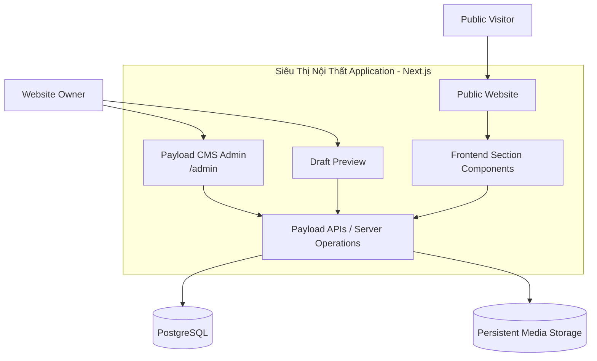
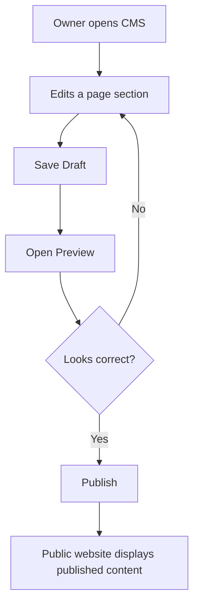

# SIÊU THỊ NỘI THẤT – SYSTEM ARCHITECTURE

**Version:** 2.0  
**Architecture style:** Modular Monolith  
**Primary stack:** Next.js + Payload CMS + PostgreSQL

---

## 1. Architecture Goals

The architecture must:

- Support a premium public website.
- Provide an owner-only CMS.
- Allow form-based editing and frontend preview.
- Support structured homepage sections.
- Separate content from presentation.
- Support draft and published content.
- Store uploaded media persistently.
- Remain simple enough for one developer or a small team to maintain.

Use a modular monolith for the first release. Do not introduce microservices.

## 2. High-Level Architecture



### Main components

| Component | Responsibility |
|---|---|
| Next.js | Public website, routing, rendering, frontend components |
| Payload CMS | Admin dashboard, authentication, collections, globals, content operations |
| PostgreSQL | Users and structured content |
| Media Storage | Uploaded images and other media |
| Preview | Renders draft content using public frontend components |

The CMS and public website should share the same application where supported by the chosen Payload and Next.js versions.

## 3. Application Modules

Suggested logical modules:

```text
src/
├── app/
│   ├── (frontend)/
│   │   ├── page.tsx
│   │   ├── about/
│   │   ├── services/
│   │   ├── projects/
│   │   └── contact/
│   │
│   ├── (payload)/
│   │   └── admin/
│   │
│   └── api/
│
├── components/
│   ├── layout/
│   ├── navigation/
│   ├── sections/
│   ├── projects/
│   ├── services/
│   └── ui/
│
├── blocks/
│   ├── Hero/
│   ├── BrandIntroduction/
│   ├── Services/
│   ├── FeaturedProjects/
│   ├── DesignPhilosophy/
│   ├── WhyChooseUs/
│   ├── CTA/
│   └── Contact/
│
├── collections/
│   ├── Users.ts
│   ├── Media.ts
│   ├── Projects.ts
│   ├── Services.ts
│   └── Pages.ts
│
├── globals/
│   ├── SiteSettings.ts
│   └── Navigation.ts
│
├── lib/
│   ├── payload/
│   ├── preview/
│   └── utils/
│
├── data/
│   └── mock/
│
└── payload.config.ts
```

This is a logical starting structure. The actual directory layout must follow the Payload version and official installation conventions selected during implementation. Do not force this exact tree if it conflicts with the framework's required structure.

## 4. Content Model

### 4.1 Users

Purpose: CMS authentication.

Initial policy:
- One Owner account.
- No public registration.
- Owner can manage all content.
- Authorization enforced on the server.
- Future roles can be added without redesigning all collections.

### 4.2 Media

Fields:
- `alt`
- `filename`
- `mimeType`
- `filesize`
- `url` (managed by the storage adapter)
- Optional image dimensions

Requirements:
- Upload image files.
- Reuse media across sections and projects.
- Validate allowed MIME types and maximum size.
- Store media persistently in production.
- Do not delete media that is still referenced without a safe confirmation or reference check.

### 4.3 Projects

Suggested fields:

| Field | Type |
|---|---|
| name | Text |
| slug | Unique text |
| category | Select |
| description | Rich text or structured text |
| area | Text |
| designStyle | Text |
| coverImage | Media relationship |
| gallery | Media relationship array |
| featured | Boolean |
| displayOrder | Number |
| status | Draft / Published |
| isMock | Boolean during mock-data phase |

Projects should support a public detail page at `/projects/[slug]`.

### 4.4 Services

Suggested fields:

- title
- slug
- shortDescription
- description
- image
- displayOrder
- published status

### 4.5 Pages

A page should contain:
- title
- slug
- SEO fields
- structured sections / blocks
- publication status

The homepage is a page with a controlled set of block types.

### 4.6 Site Settings

Use a global configuration for:
- Brand name
- Logo
- Hotline
- Zalo URL
- Facebook URL
- Business email
- Showroom address
- Footer details
- Default SEO metadata

Only render contact links when their values are configured and valid.

### 4.7 Navigation

Use a global configuration for:
- Menu items
- Labels
- Internal page or external URL
- Display order
- Visibility

Avoid hardcoding navigation labels in multiple components.

## 5. Block-Based Homepage Architecture

Use Payload blocks or an equivalent structured block model.

Initial block types:

| Block | Editable fields |
|---|---|
| Hero | Heading, subtitle, image, CTA label, CTA destination |
| Brand Introduction | Heading, text, image |
| Services | Heading, selected services, display settings |
| Featured Projects | Heading, selected projects |
| Design Philosophy | Heading, text, image |
| Why Choose Us | Heading, feature items, optional image |
| CTA | Heading, description, button label, destination |
| Contact | Heading, contact details or settings reference |

Example conceptual data:

```ts
type HomepageSection =
  | {
      blockType: "hero";
      heading: string;
      subtitle?: string;
      image?: Media;
      ctaLabel?: string;
      ctaUrl?: string;
    }
  | {
      blockType: "brandIntroduction";
      heading: string;
      body: string;
      image?: Media;
    }
  | {
      blockType: "featuredProjects";
      heading: string;
      projects: Project[];
    }
  | {
      blockType: "cta";
      heading: string;
      description?: string;
      ctaLabel?: string;
      ctaUrl?: string;
    };
```

This is a conceptual TypeScript example, not a final Payload schema. Implement each block using Payload's supported block configuration and generated types.

### Block rendering

The frontend should use a controlled renderer:

```tsx
function RenderPageSections({ sections }) {
  return sections.map((section) => {
    switch (section.blockType) {
      case "hero":
        return <HeroBlock key={section.id} {...section} />;

      case "brandIntroduction":
        return (
          <BrandIntroductionBlock
            key={section.id}
            {...section}
          />
        );

      case "featuredProjects":
        return (
          <FeaturedProjectsBlock
            key={section.id}
            {...section}
          />
        );

      case "cta":
        return <CtaBlock key={section.id} {...section} />;

      default:
        return null;
    }
  });
}
```

Expand the renderer to cover all supported block types. Add exhaustive type handling where practical.

Do not render arbitrary HTML or execute user-supplied JavaScript.

## 6. Form Editor + Preview

The owner should not need to edit JSON or source code.

### Form Editor

The CMS provides structured fields for each block.

Example: Hero editor

- Heading
- Subtitle
- Hero image
- CTA label
- CTA destination
- Save draft

### Preview

Preview must:
- Render using the actual public frontend components.
- Display draft content without publishing it.
- Support desktop and mobile preview where practical.
- Be protected so unauthenticated visitors cannot access draft content.
- Clearly distinguish preview from the live public page.

### Preview flow



Use the official Payload preview and draft/version capabilities supported by the installed version. Do not implement a parallel publishing mechanism without a clear technical reason.

## 7. Content Lifecycle

The expected lifecycle:

- Draft: editable and not visible to public visitors.
- Published: visible on the public website.
- Updated draft: changes are not public until published.

Use Payload's supported drafts and versions configuration where applicable.

Define how the frontend fetches published content and how preview mode retrieves drafts. Ensure draft data cannot leak through public endpoints or cached responses.

## 8. Data Access & Rendering

Recommended responsibilities:

- Collections and Globals define content structure.
- Payload handles persistence and CMS operations.
- Server-side data access retrieves public content.
- Frontend block components render content.
- Preview logic retrieves draft content only for authorized preview sessions.

Prefer server-side data access for public pages. Avoid exposing privileged Payload credentials or secrets in client-side code.

Configure cache invalidation or revalidation after publishing so the public site reflects new content without requiring a manual redeploy.

## 9. Media Storage

Development:
- Local media storage may be used temporarily.

Production:
- Use persistent object storage or a managed media provider.
- Configure the appropriate Payload storage adapter.
- Keep storage credentials in environment variables.
- Ensure uploaded files survive application redeployment.
- Do not treat the hosting platform's ephemeral filesystem as permanent storage.

The exact provider is a deployment decision and should remain configurable.

## 10. Security Architecture

- Protect `/admin`.
- Disable public user registration.
- Enforce Owner authorization on server-side operations.
- Protect draft preview.
- Validate all input.
- Restrict uploads.
- Keep secrets server-side.
- Apply secure cookie/session configuration.
- Avoid exposing draft content through public queries.
- Use least-privilege database and storage credentials.
- Confirm production authentication and authorization behavior before launch.

## 11. Environment Configuration

Create `.env.example` with documented variable names, for example:

```env
DATABASE_URL=
PAYLOAD_SECRET=
NEXT_PUBLIC_SERVER_URL=
```

Add media storage credentials only after selecting a provider.

Never commit real `.env` files or production secrets.

## 12. Key Architectural Decisions

| Decision | Choice | Reason |
|---|---|---|
| Architecture | Modular monolith | Avoid unnecessary distributed complexity |
| CMS | Payload CMS | Integrated content management with Next.js |
| Database | PostgreSQL | Structured persistent content |
| Content model | Collections + Globals + Blocks | Reusable and controlled content |
| Editing | Form + Preview | Easy for owner, reliable for developers |
| Roles | Owner only | Matches initial business requirement |
| Media | Persistent object storage | Reliable production image hosting |
| Publishing | Draft / Publish | Prevent accidental live changes |
| Frontend | Shared public components | Preview matches actual website |

## 13. Important Implementation Constraints

1. Check the current project's dependencies before installing or upgrading anything.
2. Verify compatibility between Next.js, Payload CMS, PostgreSQL adapter, and supporting packages.
3. Follow the official installation conventions for the selected versions.
4. Do not create a separate NestJS backend for the CMS in the first release.
5. Do not build an unrestricted drag-and-drop page builder.
6. Do not duplicate the public website's section components in the preview.
7. Do not allow draft content to appear publicly.
8. Do not store production media on an ephemeral filesystem.
9. Keep mock data replaceable through CMS.
10. Do not invent real business information.

**Architecture principle:** Payload manages content; Next.js renders the experience; PostgreSQL stores structured data; persistent media storage holds uploaded assets.